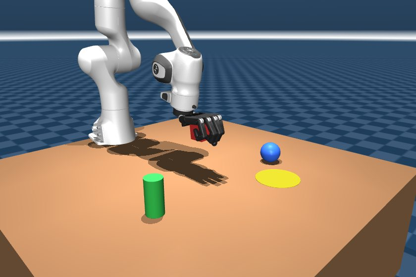
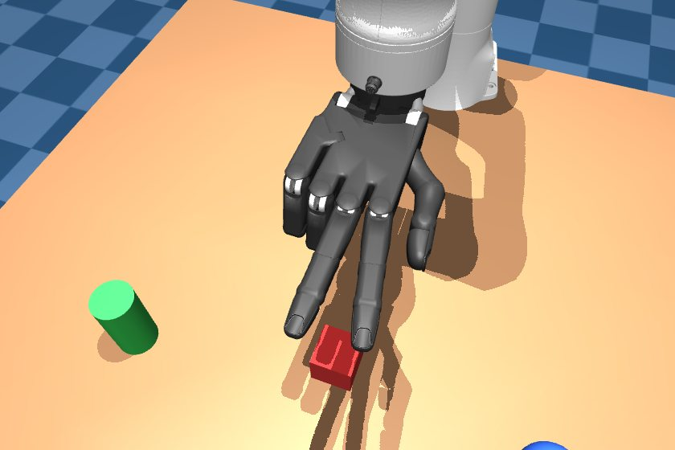
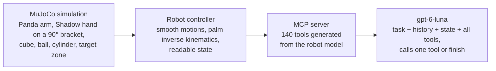
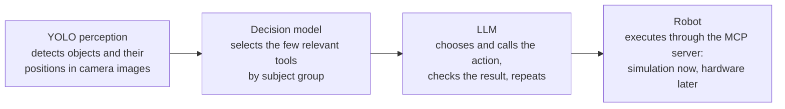

# Panda Hand Tool Control

A Franka Panda arm with a five-fingered Shadow hand runs in MuJoCo. Everything it can do is exposed as
140 MCP tools, and `gpt-6-luna` controls it by calling those tools one at a time. On a 10-task benchmark
judged by the simulator, it completed 9 tasks as scored, and 10 once a strict check was corrected.

`9 Oct 2026` · `model gpt-6-luna` · `MuJoCo 3.15 · MCP 2.3 · OpenAI SDK 3.26`

| | |
|---|---|
| **9 / 10** | tasks passed the simulator check (10 / 10 after the check fix) |
| **3.8** | tool calls per task on average (1 for gestures, 4–12 to move objects) |
| **18 s** | average time per task, mostly LLM thinking (robot motion ~1 s per call) |
| **75k** | input tokens per task on average, ~15.4k per call (the 140 tool schemas) |

| | |
|---|---|
|  |  |
| Lift task: the hand has closed around the red cube and raised it 12 cm. | Peace-sign task, seen from above: done in one call with `hand_pose_scissors`. |

## How it works

The model sees the robot only through its tools.



- **MuJoCo simulation:** Panda arm on a table, Shadow hand on a 90° bracket, red cube, blue ball, green cylinder, yellow target zone.
- **Robot controller:** smooth motions, inverse kinematics for the palm, and a readable state: palm pose, finger curl, and which objects are held, lifted or in the zone.
- **MCP server:** 140 tools generated from the robot model itself: every actuator, the hand's built-in poses, palm moves, objects, sensing.
- **gpt-6-luna:** each turn it gets the task, the action history and the current state, plus all tools. It calls exactly one tool, or `finish`.

### Tool catalog

| Group | Tools | Examples |
|---|---|---|
| Single actuators | 81 | `index_knuckle_toward_palm`, `arm_base_move_left`, `wrist_bend_set_angle` |
| Whole finger | 15 | `curl_index`, `straighten_thumb`, `set_ring_curl` |
| Hand poses | 13 | `hand_pose_close_hand`, `hand_pose_point` |
| Palm moves | 13 | `move_palm_up`, `turn_palm_to_face_left` |
| Objects and zone | 8 | `move_palm_above_red_cube` |
| Sensing and utility | 8 | `get_robot_state`, `reset_scene` |
| Finger spread | 2 | `spread_fingers_apart` |

### Built from the model, not guessed

Every one of the 27 actuators gets three tools: set an angle, nudge it one way, nudge it the other way.
Direction names come from measuring what each joint actually moves, so `index_knuckle_toward_palm` really
bends the index finger toward the palm. Measuring caught cases a hand-written list would get wrong: the
ring and little fingers spread the opposite way from the index and middle.

Success is never taken from the model's word. Each task has a check run on the final simulator state,
such as "ring and little fingers curled past 0.6" or "cube resting inside the zone and not held".

## Benchmark

One run per task, run headless in parallel, at most 20 steps each.

| Task | Result | Tool calls | Time | Input tokens | What happened |
|---|---|---|---|---|---|
| Lift the red cube 10 cm | ✅ Pass | 4 | 18 s | 78k | Approach, lower, close hand, lift 12 cm. No wasted calls. |
| Red cube into the zone | ✅ Pass | 8 | 29 s | 141k | Clean pick and place; after opening, straightened the thumb to clear the cube. |
| Blue ball into the zone | ✅ Pass | 12 | 51 s | 204k | Cycled grasp poses six times because the ball didn't count as held until lifted. |
| Green cylinder into the zone | ✅ Pass | 7 | 27 s | 125k | Clean pick and place in 7 calls. |
| Peace sign | ✅ Pass | 1 | 8 s | 31k | `hand_pose_scissors`, done. |
| Point with the index finger | ✅ Pass | 1 | 10 s | 31k | `hand_pose_point`, done. |
| Make a fist | ✅ Pass | 2 | 13 s | 46k | `hand_pose_rock`, then read the state to confirm. |
| Bend only the index finger | ❌ Fail · ✅ Pass after fix | 1 | 10 s | 31k | `set_index_curl(0.5)`, a half bend. Failed the original full-curl check; passes the corrected one. |
| Hover above the blue ball | ✅ Pass | 1 | 8 s | 31k | `move_palm_above_blue_ball`, done. |
| Palm facing left | ✅ Pass | 1 | 5 s | 31k | `turn_palm_to_face_left`, done. |

## Findings

**It works out multi-step manipulation by itself.** All four pick-and-place tasks passed. The model found
the sequence approach → lower → close hand → lift → carry → lower → open on its own, from the tool
descriptions and the state after each step.

**Gestures and orientation take one call.** It goes straight to the matching high-level tool
(`hand_pose_scissors`, `hand_pose_point`, `turn_palm_to_face_left`) instead of driving joints one by one.

**The "held" signal is too late for the ball.** An object only counts as held once it is off the table. On
the ball task the grasp was fine, but the state still said "not held", so the model cycled through grasp
poses for six extra calls before lifting. Reporting "grasped" separately from "lifted" should fix this.

**One check was stricter than its wording.** For "bend only the index finger" the model bent it halfway
(curl 0.52). The check required a full curl (above 0.6). The check now accepts a clear bend (above 0.3), and
a replay of the same action passes it. The model also claimed success without reading the state first; it
rarely double-checks gestures.

**Cost is dominated by the tool list.** Every call carries all 140 tool schemas, about 15.4k input tokens,
while output is tiny (about 70 tokens per call). Prompt caching of the fixed tool list, or fewer, broader
tools, would cut this the most.

## The decision-model stage, and why it was dropped

The original plan put a decision model in front of the LLM, so it would see only the top 5% of tools
(7 of 140) each step.

- **Embedding similarity.** Cheap (about 100 tokens per step), but it offered the tool needed for the next
  step at only 20 of 31 task stages (65%). It never offered grasp, release or lift tools for "put the cube
  in the zone", and that live run failed after 20 steps.
- **OpenAI Decisions API.** One yes/no question per tool, ranked by probability. The ranking was good
  (close hand, grasp variants, then lift), but each step cost about 30k input tokens, twice what the LLM
  itself uses when given every tool.

So the shortlist was removed and `gpt-6-luna` gets the tools directly. The `decision/` code remains in the
repository, unused.

## Token use

| Activity | Input tokens |
|---|---|
| Benchmark, 10 tasks | 748k |
| Live run with the viewer (cube to zone) | 156k |
| Decisions API experiments | ≈129k |
| Failed decision-model run | 31k |
| **Total** | **≈1.06M** |

Output was only a few thousand tokens in total; embedding calls were negligible.

## Next steps

1. Report "grasped" separately from "lifted", so the model stops re-grasping.
2. Add a short rule to the instructions: read the state before calling `finish`.
3. Cache the fixed tool list to cut input cost per call.
4. Rerun the benchmark with 3 repeats for steadier numbers (about 2.2M tokens).
5. Add harder tasks: stacking, handing an object between positions, two objects in sequence.

## Setup and reproduce

Requires macOS or Linux with [uv](https://docs.astral.sh/uv/). The viewer on macOS runs under `mjpython`
(wrapped by `scripts/mjpython.sh`).

```bash
uv sync                                      # install dependencies
scripts/fetch_assets.sh                      # download the Panda + Shadow hand models
cp .env.example .env                         # then add your OPENAI_API_KEY
scripts/mjpython.sh -m robot_sim.server      # simulation window
uv run python -m robot_tools.mcp_server      # MCP server (140 tools), e.g. for MCP Inspector
uv run python -m agent.run "Put the red cube in the yellow target zone."
uv run python -m evaluation.run --workers 4  # benchmark, report in evaluation/results/
uv run pytest -q                             # 33 tests
```

### Project layout

| Path | What it is |
|---|---|
| `robot_sim/` | Scene (Panda + Shadow hand + objects), inverse kinematics, controller, simulation server and client |
| `robot_tools/` | Tool catalog generated from the model, MCP server, `tools.json` export |
| `agent/` | The LLM agent loop and tool executors (MCP or in-process) |
| `evaluation/` | Benchmark tasks with simulator checks, and the benchmark runner |
| `decision/` | The dropped decision-model stage (embeddings and Decisions API), kept for reference |
| `tests/` | Test suite (fake OpenAI client; no API key needed) |

## Improvements planned

**Decision model to cut tool-picking time.** Bring back a decision model in front of the LLM so each turn
carries only the few tools that matter for the next step instead of all 140. Fewer tool schemas per call
means faster responses and lower cost. This round showed what it needs: it must follow the task's progress
(approach, grasp, lift, release), not just match the task's wording, which is where plain embedding
similarity fell short.

**Subject-wise division of the MCP tools.** Organise the MCP server by subject (arm, wrist, each finger,
hand poses, palm movement, objects, sensing) instead of one flat list of 140 tools. Clear groups make the
catalog easier to read for people and models, and give the decision model a natural first cut: pick the
right subject, then the right tool inside it.

**YOLO for real-world perception.** Integrate a YOLO object detector so the robot can find objects from
camera images rather than reading exact positions from the simulator. This is the step toward real
environments, where object positions, types and the clutter around them have to be seen, not looked up.

**One pipeline: see, select, act.** Combine the three: YOLO describes the scene, the decision model uses
that understanding to select the relevant tools, and the LLM takes the actions.



---

Results from `evaluation/results/20261009-104301` and `20261009-104758`, plus `runs/20261009-104250.json`
(viewer run) and `runs/20261009-102809.json` (decision-model run).
